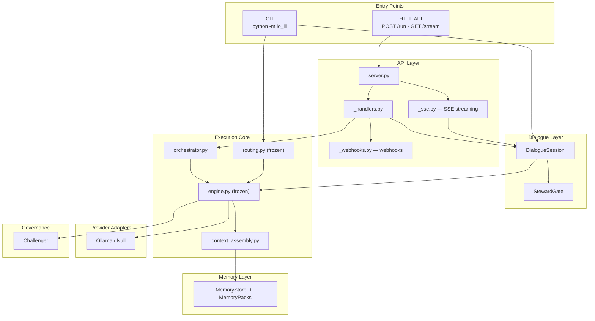

<p align="center">
  
</p>

# I0³ | Deterministic AI Runtime

[](https://github.com/CevenJKnowles/io-iii-runtime/actions/workflows/ci.yml)

I0³ is a local control plane for language models. It sits between your prompt and the model, sends each request to one model chosen from a fixed routing table, and keeps every run within set limits, so you know what it will do before it runs. Prompts and model output are kept out of the logs, and a session can be paused for human approval at points you configure. It runs on Ollama and comes with a command line, an HTTP API and a web UI. The reasoning behind it is in [Why I0³ exists](docs/user-guide/WHY-IO3.md).

## What I0³ enforces

- Each request goes to exactly one provider, chosen from a static routing table. There is no dynamic model selection.
- A run is limited to one audit pass and one revision pass, with set limits on capability calls and session turns.
- With `--audit`, a second model called the challenger reviews the draft before you see it. It can send the draft back for one revision.
- Prompts, model completions and memory values are kept out of logs and metadata. API responses include model output only when `content_release` is enabled.
- Every structural change needs an accepted Architecture Decision Record before implementation starts.
- `routing.py`, `engine.py` and `telemetry.py` must not be modified (DOC-GOV-001, Rule 2). New behaviour goes in layers above them.
- Sessions run in work mode, which is autonomous, or in steward mode, which pauses at configurable limits (step count, token budget or capability class) until a human approves.

## Quick start

You need [Ollama](https://ollama.com) running locally with at least one model pulled, and Python 3.11 or later.

```bash
git clone https://github.com/CevenJKnowles/io-iii-runtime.git
cd io-iii-runtime
python -m venv .venv
source .venv/bin/activate
pip install -e ".[dev]"
```

The web UI and API return model output only when `content_release: true` is set in `architecture/runtime/config/runtime.yaml` (ADR-026). The checked-in config already sets it. Review access control and log retention before exposing the server beyond localhost.

### Single run

```bash
python -m io_iii run executor --prompt "Explain deterministic routing in one sentence."
```

### Multi-turn session

```bash
python -m io_iii session start --mode work
python -m io_iii session continue --session-id <uuid> --prompt "Next question."
```

### Web UI

```bash
python -m io_iii serve   # binds to 127.0.0.1:8080; open http://127.0.0.1:8080
```

For model configuration, error reference, and all modes: [docs/user-guide/GETTING_STARTED.md](docs/user-guide/GETTING_STARTED.md).

## System architecture



## Non-goals

I0³ is not an agent framework, an autonomous reasoning pipeline, a dynamic tool orchestrator, a retrieval or embedding system, a multi-model arbitration system or a cloud deployment platform. Each of these is a non-goal governed by an ADR.

## Documentation

| | |
|---|---|
| Getting started | [docs/user-guide/GETTING_STARTED.md](docs/user-guide/GETTING_STARTED.md) |
| Why I0³ exists | [docs/user-guide/WHY-IO3.md](docs/user-guide/WHY-IO3.md) |
| Model configuration | [docs/user-guide/MODELS.md](docs/user-guide/MODELS.md) |
| Configuration reference | [docs/user-guide/CONFIGURATION.md](docs/user-guide/CONFIGURATION.md) |
| Running in Docker | [docs/user-guide/DOCKER.md](docs/user-guide/DOCKER.md) |
| Architecture decision records | [ADR/](ADR/) |
| Worked examples | [examples/](examples/) |
| Changelog | [CHANGELOG.md](CHANGELOG.md) |
| Contributing | [CONTRIBUTING.md](CONTRIBUTING.md) |

The architecture docs are under `docs/`. Start with `docs/overview/DOC-OVW-001-architecture-overview-index.md`.

## Project status

The latest stable tag is `v1.0.0`, the Phase 10 public release. There are 34 Architecture Decision Records and 1,182 tests, which run in CI on Python 3.11 and 3.12. The code is under the Apache License 2.0 and the documentation under CC BY-NC 4.0. See [NOTICE](NOTICE). The history is in [CHANGELOG.md](CHANGELOG.md).
